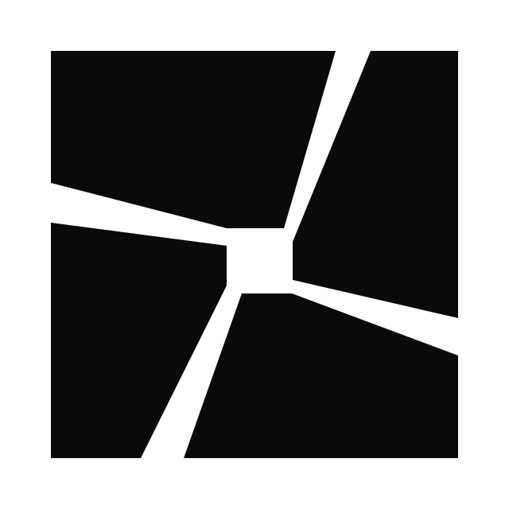
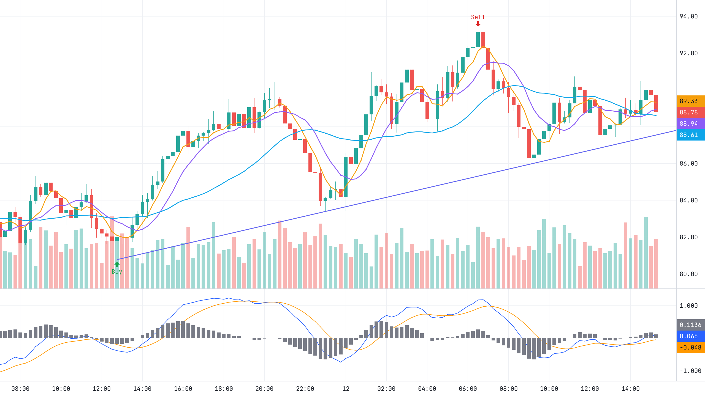
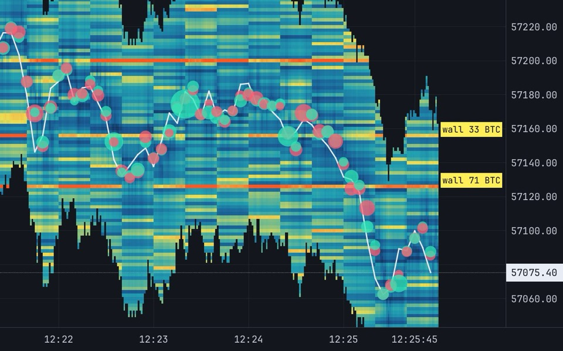
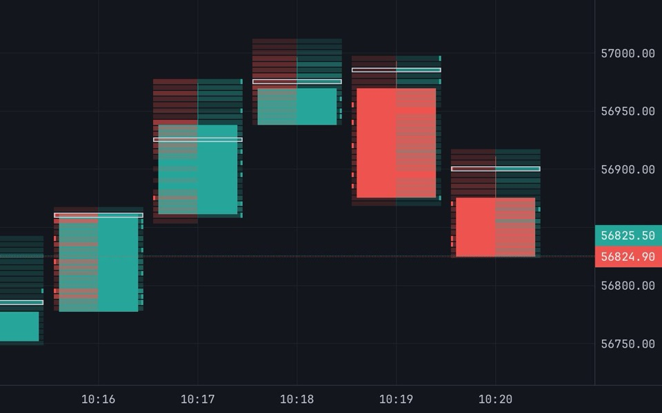
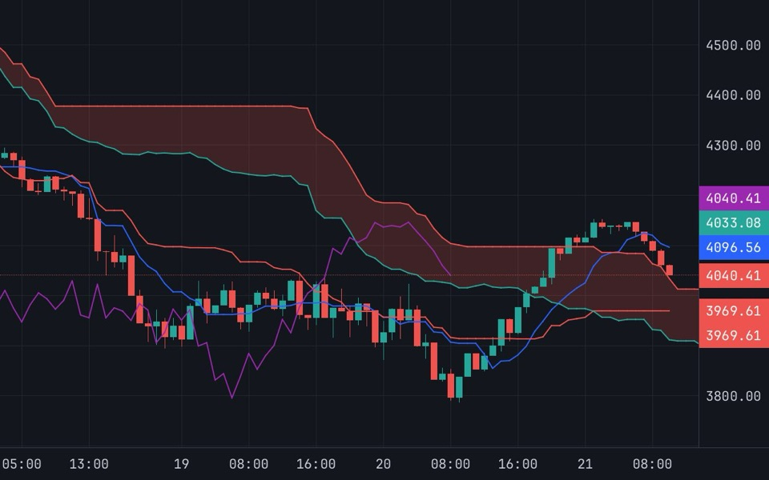
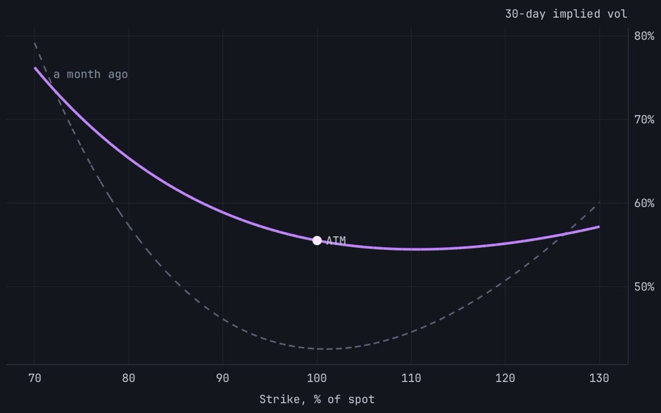

<div align="center">



<h1>FerroChart</h1>

English | [简体中文](README.zh-CN.md)

**GPU-rendered financial charts for every platform. One Rust core, millions of bars, zero allocations per frame.**

[](LICENSE-APACHE)
[](Cargo.toml)
[](#platforms)
[](#performance)
[](https://ferrochart.com/docs/api)

[**Documentation**](https://ferrochart.com/docs) ·
[**308 live examples**](https://ferrochart.com/#library) ·
[API reference](https://ferrochart.com/docs/api) ·
[Changelog](CHANGELOG.md) ·
[Contributing](CONTRIBUTING.md)

<br>

<a href="https://ferrochart.com"></a>

</div>

## Why FerroChart

- **Fast at any size.** Bar data lives on the GPU and coordinate transforms run in
  shaders, so panning and zooming cost the same with 1,000 bars or 10 million. A
  level-of-detail pyramid keeps zoomed-out views smooth and free of moiré.
- **One engine everywhere.** The same Rust core runs in the browser (WebAssembly),
  in native apps (Metal, Vulkan, DirectX 12), in Python and Jupyter, behind a C ABI
  for C#, C++, Qt and Flutter, and on servers without a GPU.
- **Identical pixels.** The GPU and CPU backends share every transform, step for
  step, and are checked against the same golden images.
- **Built like a library you can trust.** No panics in the public API, no heap
  allocations while panning, zooming or streaming (tested), no `unsafe` in the core.
- **Just the chart.** No data feeds, network calls, accounts or telemetry. You bring
  the data; FerroChart renders it and handles interaction.

## Features

| | |
|---|---|
| **Series** | Candlestick, OHLC, Heikin-Ashi, line, area, baseline, histogram, volume; Renko, range bars, Kagi, point & figure |
| **Order flow** | Footprint, order-book heatmap (a GPU compute shader), TPO / market profile |
| **Indicators** | 30 built in, from SMA to Ichimoku, updated incrementally on every tick and tested against reference data |
| **Drawing tools** | 29 tools: trend lines, channels, Fibonacci, pitchforks, Gann fans, patterns, Elliott waves, ranges, positions, text; undo/redo |
| **Layout** | Multiple panes, linear / log / percentage / indexed scales, markers with images and badges, price lines, light and dark themes |
| **Sync** | Linked crosshair, visible range and drawings across charts |
| **State** | View, panes and drawings save to and load from JSON |
| **Plots** | `FerroPlot` for non-time charts: scatter, bars, heatmaps, payoff diagrams, volatility smiles |
| **Extensible** | Plugins for custom series, layers, indicators, transforms and drawing tools |
| **Easy to adopt** | TypeScript types, React and Vue guides, a [lightweight-charts](https://ferrochart.com/docs/migrate) compatibility layer |

## Quick start

### JavaScript / TypeScript

```bash
npm install @ferrochart/core
```

```ts
import { FerroChart } from '@ferrochart/core';

const chart = await FerroChart.create(document.querySelector('canvas')!, { theme: 'dark' });

const candles = chart.addCandlestickSeries();
candles.setData(bars);                              // { time, open, high, low, close, volume } columns or rows
chart.addVolumeSeries(candles);
chart.addIndicator(candles, 'ema', { n: 20 });
chart.addIndicator(candles, 'macd');                // in its own pane

chart.on('crosshairMove', (e) => console.log(e.point?.bar));
candles.update(lastBar);                            // live tick: same time updates, a later time appends
```

### Rust

```rust
use ferrochart_core::{Chart, ChartOptions};
use ferrochart_indicators::named::ChartExt;

let mut chart = Chart::new(ChartOptions::default());
let candles = chart.add_candlestick()?;
chart.add_volume(candles)?;
chart.set_data(candles, bars)?;                     // OhlcColumns
chart.add_indicator_by_name(candles, "ema", &[("n", 20.into())])?;
ferrochart_winit::show(chart)?;                      // a native window
```

### Python

```python
import ferrochart as fc

chart = fc.Chart(theme="dark")
candles = chart.add_series("candlestick")
candles.set_data(df)                                # pandas or polars DataFrame
chart.add_indicator(candles, "ema", n=20)

chart.show()                                        # a native window
chart.to_png("chart.png")                           # offscreen
chart                                               # in Jupyter: an interactive widget
```

C, C# and C++ go through the C ABI; see [C, C++ and C#](https://ferrochart.com/docs/native).

## Platforms

| Platform | Package | Renderer |
|---|---|---|
| Web | `@ferrochart/core` (npm) | WebGPU, falling back to WebGL2 |
| Desktop (Rust) | `ferrochart-winit` | wgpu: Metal, Vulkan, DirectX 12 |
| Python / Jupyter | `ferrochart` (PyPI) | native window, notebook widget, PNG |
| C, C#, C++, Qt, Flutter | `ferrochart-ffi` (C ABI) | native window or offscreen pixels |
| Server / headless | `ferrochart-render-cpu` | CPU (tiny-skia), no GPU needed |

## Performance

Apple M4 Max. Browser figures are Google Chrome with WebGPU; the rest are native
release builds.

| | Measured | Target |
|---|---:|---:|
| Load 1M bars and draw the first frame, in the browser | **43 ms** | |
| Load 10M bars natively, LOD pyramid included | **73 ms** | < 300 ms |
| Core CPU time per pan / zoom frame, 1M or 10M bars | **19 µs** | < 0.5 ms |
| End-to-end pan / zoom frame, 10M bars, 3200×1800 px (p99) | **2.9 ms** | < 8 ms |
| Real-time update of the last bar | **0.3 µs** | < 20 µs |
| Memory per OHLCV bar | **58 B** | < 64 B |
| Heap allocations per frame while panning, zooming, streaming | **0** | 0 |
| WebAssembly package, gzip, all features | **1.4 MB** | ≤ 1.5 MB |

The same page in each library, 1M one-minute bars, Chrome
([method and full table](examples/compare/README.md)):

| | Load → first paint | Pan with 100k bars visible (p95 / dropped frames) |
|---|---:|---:|
| **FerroChart** (WebGPU) | **43 ms** | **9.3 ms / 0 %** |
| lightweight-charts 5.3.0 | 1603 ms | 74.9 ms / 36 % |

## Gallery

Every image is a live example on [ferrochart.com](https://ferrochart.com/#library),
with its source code.

<table>
  <tr>
    <td width="50%"><a href="https://ferrochart.com/charts/orderflow/bookmap"></a><br><sub><b>Liquidity heatmap</b> with trades</sub></td>
    <td width="50%"><a href="https://ferrochart.com/charts/orderflow/footprint"></a><br><sub><b>Footprint</b>: volume at every price of every bar</sub></td>
  </tr>
  <tr>
    <td width="50%"><a href="https://ferrochart.com/charts/indicators/ichimoku"></a><br><sub><b>Ichimoku cloud</b>, one of 30 indicators</sub></td>
    <td width="50%"><a href="https://ferrochart.com/charts/options/smile"></a><br><sub><b>Volatility smile</b>, drawn with <code>FerroPlot</code></sub></td>
  </tr>
</table>

## Documentation

- [Getting started](https://ferrochart.com/docs/web): web, [React and Vue](https://ferrochart.com/docs/frameworks), [desktop](https://ferrochart.com/docs/desktop), [Python](https://ferrochart.com/docs/python), [C, C++ and C#](https://ferrochart.com/docs/native), [offscreen](https://ferrochart.com/docs/offscreen)
- Guides: [series](https://ferrochart.com/docs/series), [data and real-time updates](https://ferrochart.com/docs/data), [indicators](https://ferrochart.com/docs/indicators), [drawing tools](https://ferrochart.com/docs/drawings), [order flow](https://ferrochart.com/docs/orderflow), [plugins](https://ferrochart.com/docs/plugins)
- [JavaScript API reference](https://ferrochart.com/docs/api) and the [Rust API](https://ferrochart.com/docs/rust-api)
- [Migrating from lightweight-charts](https://ferrochart.com/docs/migrate) · [How rendering works](https://ferrochart.com/docs/rendering) · [Performance guide](https://ferrochart.com/docs/performance)

## Architecture

```
┌──────────────────────────── Bindings and hosts ───────────────────────────┐
│  ferrochart-wasm    ferrochart-py    ferrochart-ffi    ferrochart-winit    │
├───────────────────────────── Render backends ─────────────────────────────┤
│  ferrochart-render-wgpu (GPU, primary)    ferrochart-render-cpu (tiny-skia)│
├─────────────────────────── Core (no GPU, no I/O) ─────────────────────────┤
│  ferrochart-core        data · scales · layout · LOD · interaction ·       │
│                         drawings · scene → Frame (draw commands)           │
│  ferrochart-indicators  ferrochart-orderflow  ferrochart-plot              │
└───────────────────────────────────────────────────────────────────────────┘
```

The core decides everything about the chart (ticks, colors, layout) and outputs a
platform-independent `Frame`. Backends only draw it, so a new platform needs a
backend, not a new chart.

<details>
<summary>Workspace crates</summary>

| Crate | Purpose |
|---|---|
| [`ferrochart-core`](crates/ferrochart-core) | Data model, scales, layout, LOD, interaction, drawings, frame generation |
| [`ferrochart-indicators`](crates/ferrochart-indicators) | Incremental technical indicators |
| [`ferrochart-orderflow`](crates/ferrochart-orderflow) | Footprint, heatmap and TPO |
| [`ferrochart-plot`](crates/ferrochart-plot) | Non-time plots |
| [`ferrochart-text`](crates/ferrochart-text) | Fonts, text measurement, glyph atlas |
| [`ferrochart-render-wgpu`](crates/ferrochart-render-wgpu) | GPU backend (wgpu) |
| [`ferrochart-render-cpu`](crates/ferrochart-render-cpu) | CPU backend (tiny-skia): golden images, headless rendering |
| [`ferrochart-winit`](crates/ferrochart-winit) | Desktop windows |
| [`ferrochart-wasm`](crates/ferrochart-wasm) | WebAssembly and JavaScript bindings |
| [`ferrochart-py`](crates/ferrochart-py) | Python bindings (PyO3) |
| [`ferrochart-ffi`](crates/ferrochart-ffi) | C ABI |
| [`ferrochart-bench`](crates/ferrochart-bench) | End-to-end benchmarks |

</details>

## Building from source

Requires Rust 1.93 or newer. From a checkout of this repository:

```bash
cargo test --workspace --exclude ferrochart-py     # ferrochart-py needs Python (built with maturin)
cargo run -p example-desktop --release             # desktop demo: 10M bars with a live feed
scripts/build-npm.sh                               # the npm package, needs wasm-pack
```

See [Building from source](https://ferrochart.com/docs/building) for the Python
wheel, the C library and the site.

## Contributing

Contributions are welcome. Please read [CONTRIBUTING.md](CONTRIBUTING.md) first,
and open an issue before larger changes or changes to the public API. This project
follows the [Contributor Covenant](CODE_OF_CONDUCT.md); to report a security issue,
see [SECURITY.md](SECURITY.md).

## License

FerroChart is licensed under the [Apache License, Version 2.0](LICENSE-APACHE).

Unless you explicitly state otherwise, any contribution intentionally submitted for
inclusion in the work by you, as defined in the Apache-2.0 license, shall be licensed
as above, without any additional terms or conditions.
