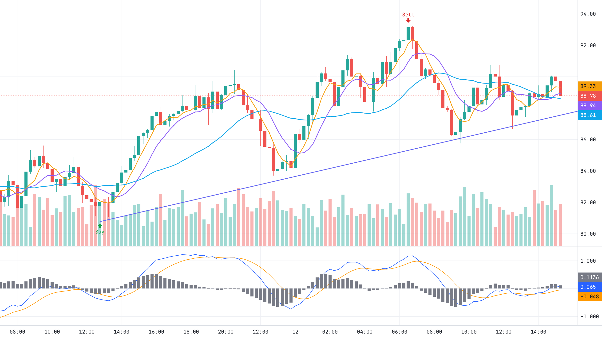
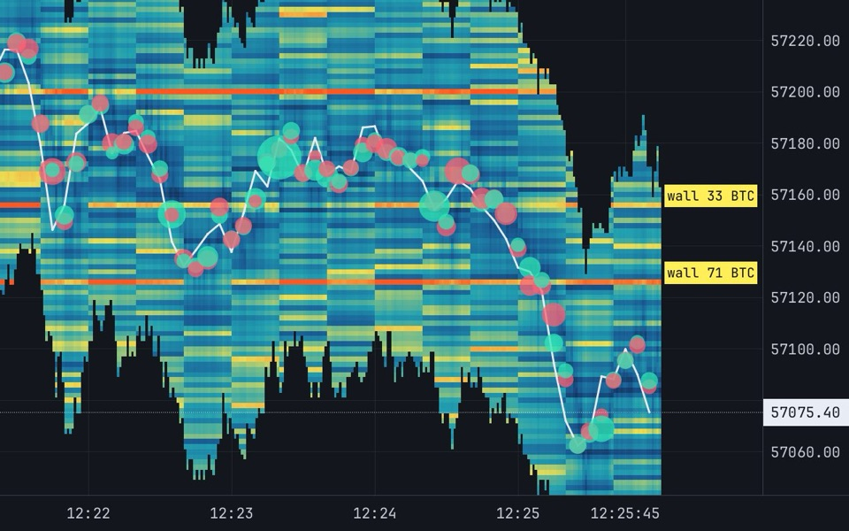
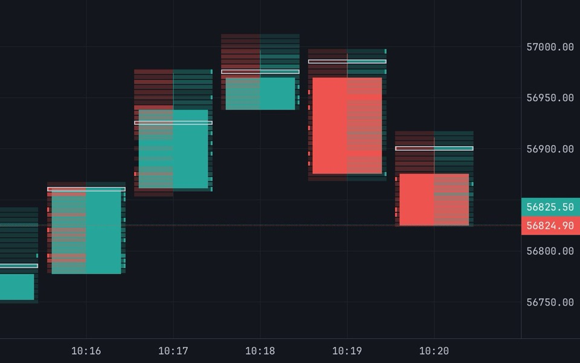
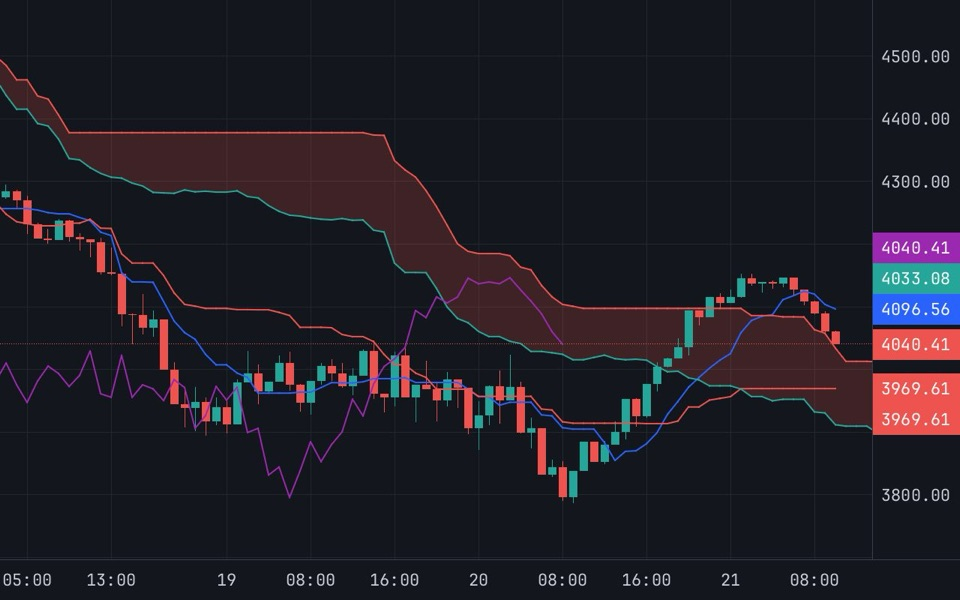
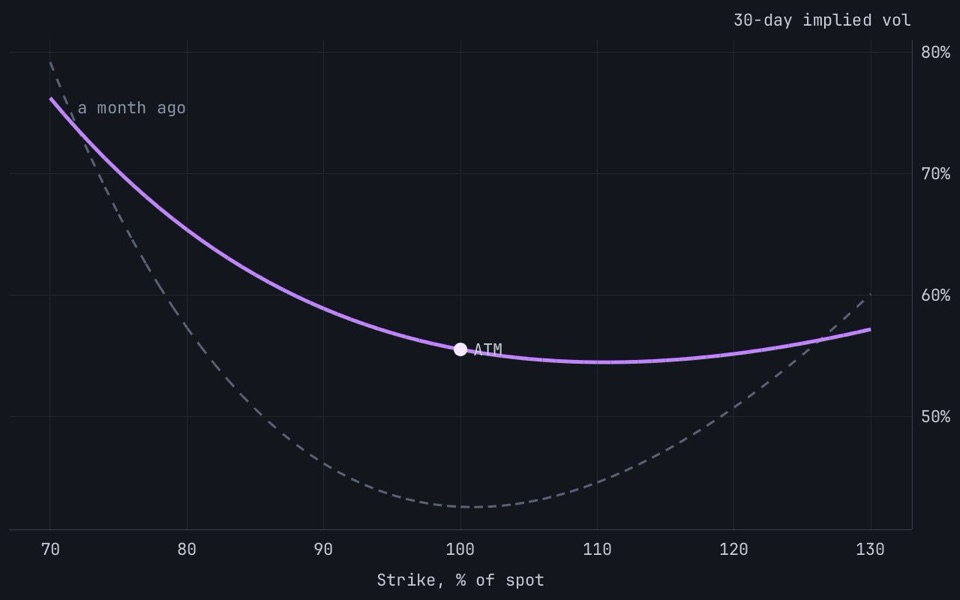

<div align="center">


<h1>FerroChart</h1>

[English](README.md) | 简体中文

**跨平台的 GPU 金融图表引擎。一个 Rust 内核，百万级 K 线，每帧零分配。**

[](LICENSE-APACHE)
[](Cargo.toml)
[](#支持的平台)
[](#性能)
[](https://ferrochart.com/docs/api)

[**文档**](https://ferrochart.com/docs) ·
[**308 个在线示例**](https://ferrochart.com/#library) ·
[API 参考](https://ferrochart.com/docs/api) ·
[更新日志](CHANGELOG.md) ·
[参与贡献](CONTRIBUTING.md)

<br>

<a href="https://ferrochart.com"></a>

</div>

> 文档目前只有英文版。

## 为什么选 FerroChart

- **数据再多也一样快。** K 线数据常驻显存，坐标变换在 shader 里完成，所以 1000 根和
  1000 万根 K 线的平移、缩放开销相同。多级细节（LOD）金字塔让缩到很远时依然流畅，也不会出现摩尔纹。
- **一个引擎，所有平台。** 同一个 Rust 内核运行在浏览器（WebAssembly）、原生应用（Metal、
  Vulkan、DirectX 12）、Python 和 Jupyter 里，通过 C ABI 供 C#、C++、Qt、Flutter 调用，
  也能在没有显卡的服务器上出图。
- **像素一致。** GPU 和 CPU 两个后端的每一步坐标变换都相同，并用同一组黄金图像校验。
- **可靠的库。** 公共 API 不会 panic；平移、缩放和实时更新时不做任何堆分配（有测试保证）；
  内核没有 `unsafe` 代码。
- **只做图表。** 没有行情源、网络请求、账号或遥测。数据由你提供，FerroChart 负责渲染和交互。

## 功能

| | |
|---|---|
| **序列类型** | K 线、美国线（OHLC）、平均 K 线（Heikin-Ashi）、折线、面积、基线、柱状图、成交量；砖形图（Renko）、等幅 K 线、卡吉图（Kagi）、点数图 |
| **订单流** | 足迹图（Footprint）、订单簿热力图（GPU 计算着色器）、TPO / 市场轮廓 |
| **指标** | 内置 30 个，从 SMA 到一目均衡表，每个 tick 增量更新，并用参考数据测试 |
| **画图工具** | 29 种：趋势线、通道、斐波那契、叉线、江恩角度线、形态、艾略特波浪、区间、仓位、文字；支持撤销/重做 |
| **布局** | 多窗格，普通 / 对数 / 百分比 / 指数化刻度，标记、价格线，浅色和深色主题 |
| **联动** | 多图之间同步十字光标、可见范围和画图 |
| **状态** | 视图、窗格和画图可以保存为 JSON 并恢复 |
| **通用图表** | `FerroPlot` 用于非时间轴图表：散点、柱状、热力图、期权损益图、波动率微笑 |
| **可扩展** | 插件接口：自定义序列、图层、指标、变换和画图工具 |
| **容易接入** | 自带 TypeScript 类型，有 React 和 Vue 指南，以及 [lightweight-charts](https://ferrochart.com/docs/migrate) 兼容层 |

## 快速开始

### JavaScript / TypeScript

```bash
npm install @ferrochart/core
```

```ts
import { FerroChart } from '@ferrochart/core';

const chart = await FerroChart.create(document.querySelector('canvas')!, { theme: 'dark' });

const candles = chart.addCandlestickSeries();
candles.setData(bars);                              // { time, open, high, low, close, volume }，列或行均可
chart.addVolumeSeries(candles);
chart.addIndicator(candles, 'ema', { n: 20 });
chart.addIndicator(candles, 'macd');                // 放在单独的窗格

chart.on('crosshairMove', (e) => console.log(e.point?.bar));
candles.update(lastBar);                            // 实时更新：时间相同则更新，时间更晚则追加
```

### Rust

```rust
use ferrochart_core::{Chart, ChartOptions};
use ferrochart_indicators::named::ChartExt;

let mut chart = Chart::new(ChartOptions::default());
let candles = chart.add_candlestick()?;
chart.add_volume(candles)?;
chart.set_data(candles, bars)?;                     // OhlcColumns
chart.add_indicator_by_name(candles, "ema", &[("n", 20.into())])?;
ferrochart_winit::show(chart)?;                      // 原生窗口
```

### Python

```python
import ferrochart as fc

chart = fc.Chart(theme="dark")
candles = chart.add_series("candlestick")
candles.set_data(df)                                # pandas 或 polars 的 DataFrame
chart.add_indicator(candles, "ema", n=20)

chart.show()                                        # 原生窗口
chart.to_png("chart.png")                           # 离屏出图
chart                                               # 在 Jupyter 中：可交互的组件
```

C、C# 和 C++ 通过 C ABI 调用，见 [C, C++ and C#](https://ferrochart.com/docs/native)。

## 支持的平台

| 平台 | 包 | 渲染 |
|---|---|---|
| Web | `@ferrochart/core`（npm） | WebGPU，不支持时用 WebGL2 |
| 桌面（Rust） | `ferrochart-winit` | wgpu：Metal、Vulkan、DirectX 12 |
| Python / Jupyter | `ferrochart`（PyPI） | 原生窗口、notebook 组件、PNG |
| C、C#、C++、Qt、Flutter | `ferrochart-ffi`（C ABI） | 原生窗口或离屏像素 |
| 服务端 / 无界面 | `ferrochart-render-cpu` | CPU（tiny-skia），不需要显卡 |

## 性能

测试机为 Apple M4 Max。浏览器数据为 Google Chrome + WebGPU，其余为原生 release 构建。

| | 实测 | 目标 |
|---|---:|---:|
| 浏览器中加载 100 万根 K 线并画出第一帧 | **43 ms** | |
| 原生加载 1000 万根 K 线（含 LOD 金字塔） | **73 ms** | < 300 ms |
| 平移 / 缩放一帧的内核 CPU 耗时（100 万或 1000 万根） | **19 µs** | < 0.5 ms |
| 平移 / 缩放一帧端到端，1000 万根，3200×1800 px（p99） | **2.9 ms** | < 8 ms |
| 实时更新最后一根 K 线 | **0.3 µs** | < 20 µs |
| 每根 OHLCV K 线的内存 | **58 B** | < 64 B |
| 平移、缩放、实时更新时每帧的堆分配次数 | **0** | 0 |
| WebAssembly 包体积（gzip，全部功能） | **1.4 MB** | ≤ 1.5 MB |

同一页面、100 万根 1 分钟 K 线、Chrome 下的对比（[测试方法和完整数据](examples/compare/README.md)）：

| | 加载到首帧 | 可见 10 万根时平移（p95 / 掉帧率） |
|---|---:|---:|
| **FerroChart**（WebGPU） | **43 ms** | **9.3 ms / 0 %** |
| lightweight-charts 5.3.0 | 1603 ms | 74.9 ms / 36 % |

## 示例

每张图都是 [ferrochart.com](https://ferrochart.com/#library) 上的在线示例，附有源码。

<table>
  <tr>
    <td width="50%"><a href="https://ferrochart.com/charts/orderflow/bookmap"></a><br><sub><b>流动性热力图</b>与成交</sub></td>
    <td width="50%"><a href="https://ferrochart.com/charts/orderflow/footprint"></a><br><sub><b>足迹图</b>：每根 K 线每个价位的成交量</sub></td>
  </tr>
  <tr>
    <td width="50%"><a href="https://ferrochart.com/charts/indicators/ichimoku"></a><br><sub><b>一目均衡表</b>，30 个内置指标之一</sub></td>
    <td width="50%"><a href="https://ferrochart.com/charts/options/smile"></a><br><sub><b>波动率微笑</b>，用 <code>FerroPlot</code> 绘制</sub></td>
  </tr>
</table>

## 文档

- [入门](https://ferrochart.com/docs/web)：Web、[React 和 Vue](https://ferrochart.com/docs/frameworks)、[桌面](https://ferrochart.com/docs/desktop)、[Python](https://ferrochart.com/docs/python)、[C、C++ 和 C#](https://ferrochart.com/docs/native)、[离屏渲染](https://ferrochart.com/docs/offscreen)
- 指南：[序列](https://ferrochart.com/docs/series)、[数据与实时更新](https://ferrochart.com/docs/data)、[指标](https://ferrochart.com/docs/indicators)、[画图工具](https://ferrochart.com/docs/drawings)、[订单流](https://ferrochart.com/docs/orderflow)、[插件](https://ferrochart.com/docs/plugins)
- [JavaScript API 参考](https://ferrochart.com/docs/api)和 [Rust API](https://ferrochart.com/docs/rust-api)
- [从 lightweight-charts 迁移](https://ferrochart.com/docs/migrate) · [渲染原理](https://ferrochart.com/docs/rendering) · [性能指南](https://ferrochart.com/docs/performance)

## 架构

```
┌──────────────────────────── Bindings and hosts ───────────────────────────┐
│  ferrochart-wasm    ferrochart-py    ferrochart-ffi    ferrochart-winit    │
├───────────────────────────── Render backends ─────────────────────────────┤
│  ferrochart-render-wgpu (GPU, primary)    ferrochart-render-cpu (tiny-skia)│
├─────────────────────────── Core (no GPU, no I/O) ─────────────────────────┤
│  ferrochart-core        data · scales · layout · LOD · interaction ·       │
│                         drawings · scene → Frame (draw commands)           │
│  ferrochart-indicators  ferrochart-orderflow  ferrochart-plot              │
└───────────────────────────────────────────────────────────────────────────┘
```

图表的一切（刻度、颜色、布局）都由内核决定，内核输出与平台无关的 `Frame`（一串绘制命令），
后端只负责把它画出来。所以支持一个新平台只需要一个新后端，而不是重写一遍图表。

<details>
<summary>工作区中的 crate</summary>

| Crate | 作用 |
|---|---|
| [`ferrochart-core`](crates/ferrochart-core) | 数据模型、刻度、布局、LOD、交互、画图、生成 Frame |
| [`ferrochart-indicators`](crates/ferrochart-indicators) | 增量计算的技术指标 |
| [`ferrochart-orderflow`](crates/ferrochart-orderflow) | 足迹图、热力图和 TPO |
| [`ferrochart-plot`](crates/ferrochart-plot) | 非时间轴图表 |
| [`ferrochart-text`](crates/ferrochart-text) | 字体、文字测量、字形图集 |
| [`ferrochart-render-wgpu`](crates/ferrochart-render-wgpu) | GPU 后端（wgpu） |
| [`ferrochart-render-cpu`](crates/ferrochart-render-cpu) | CPU 后端（tiny-skia）：黄金图像、无界面渲染 |
| [`ferrochart-winit`](crates/ferrochart-winit) | 桌面窗口 |
| [`ferrochart-wasm`](crates/ferrochart-wasm) | WebAssembly 与 JavaScript 绑定 |
| [`ferrochart-py`](crates/ferrochart-py) | Python 绑定（PyO3） |
| [`ferrochart-ffi`](crates/ferrochart-ffi) | C ABI |
| [`ferrochart-bench`](crates/ferrochart-bench) | 端到端基准测试 |

</details>

## 从源码构建

需要 Rust 1.93 或更新版本。在本仓库的检出目录中：

```bash
cargo test --workspace --exclude ferrochart-py     # ferrochart-py 需要 Python（用 maturin 构建）
cargo run -p example-desktop --release             # 桌面演示：1000 万根 K 线 + 实时行情
scripts/build-npm.sh                               # 构建 npm 包，需要 wasm-pack
```

Python wheel、C 库和网站的构建方法见 [Building from source](https://ferrochart.com/docs/building)。

## 参与贡献

欢迎贡献。请先阅读 [CONTRIBUTING.md](CONTRIBUTING.md)；较大的改动或涉及公共 API 的改动，请先开 issue 讨论。
本项目遵循 [Contributor Covenant](CODE_OF_CONDUCT.md) 行为准则；报告安全问题请见 [SECURITY.md](SECURITY.md)。

## 许可证

FerroChart 以 [Apache License 2.0](LICENSE-APACHE) 授权。

除非你另行明确声明，你有意提交并被纳入本项目的任何贡献，均按 Apache-2.0 许可证的定义以上述方式授权，不附加任何其他条款或条件。
